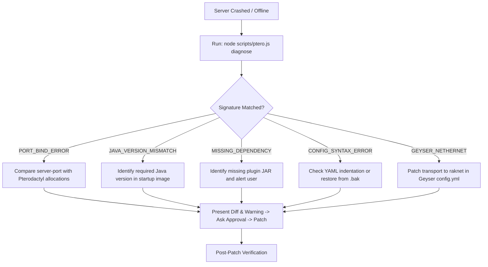

# Minecraft AIOps - Autonomous SRE Skill

This skill equips any AI Agent with the procedures, guardrails, and diagnostics to operate as an automated Site Reliability Engineer (SRE) for Minecraft servers (Paper, Purpur, Velocity, Folia) hosted on **Pterodactyl** using a **Pterodactyl Client API Key (`ptlc_...`)**.

---

## 1. Onboarding & Environment Setup

Before executing operational tasks, check if `.env` exists in the workspace root with valid values:
- `PTERO_URL`: Pterodactyl panel URL (e.g., `https://panel.example.com`).
- `PTERO_CLIENT_KEY`: Client API key starting with `ptlc_`.
- `PTERO_SERVER_ID`: Default server identifier or UUID.

> [!IMPORTANT]
> If `.env` is absent or unconfigured:
> 1. Stop and politely request credentials from the user:
>    *"Please generate an API Key in your Pterodactyl Panel (Click Account Avatar -> Account Settings -> API Credentials -> Create New). Provide your Panel URL and Client API Key (`ptlc_...`)."*
> 2. Save credentials to local `.env`.
> 3. **Secret Protection:** Never echo, log, or leak `.env` keys, database passwords, or proxy forwarding secrets in chat or logs.

---

## 2. Phase 0: Context Discovery & Architecture Fingerprinting

Do not apply generic Minecraft fixes blindly. The AI must determine the server's architectural profile:

### A. Core Software Detection
Inspect server files to identify the running platform:
- **Paper / Purpur:** Look for `paper-world-defaults.yml`, `paper-global.yml`, or `purpur.yml`.
- **Velocity Proxy:** Look for `velocity.toml`.
- **Folia:** Multi-threaded Paper fork (regions tick independently; plugins must explicitly support Folia).
- **Fabric / Forge:** Look for `mods/` directory and mod loaders.

### B. Network Topology (Standalone vs Proxy Backend)
- Check `paper-global.yml` under `proxies.velocity.enabled` or `settings.bungeecord`.
- **CRITICAL RULE:** If the server operates behind a **Velocity** or **BungeeCord** proxy:
  - **NEVER** set `online-mode: true` in `server.properties` (players authenticate through the proxy).
  - **NEVER** modify ports or IP bindings without verifying proxy routing in `velocity.toml`.
  - Ensure modern forwarding secrets match between proxy and backend.

### C. Resource Boundaries
Run `node scripts/ptero.js info` to map hard limits:
- RAM ceiling (`limits.memory` in MB).
- CPU core throttle (`limits.cpu` in %).
- Dedicated IP and open port allocations.

---

## 3. Operational Authority Zones & Guardrails

To prevent server downtime and data corruption, all actions are categorized into three strict zones:

```text
+-------------------------------------------------------------------------------+
| AUTONOMOUS ZONE (Direct Execution)                                            |
| - Resource metrics (usage)           - Log inspection (logs, diagnose)        |
| - File backup creation (*.bak)       - Config diff preview generation         |
| - Read-only commands (plugins, list, spark health, version)                   |
+-------------------------------------------------------------------------------+
| RESTRICTED ZONE (Requires Explicit User Confirmation)                         |
| - Power actions (start, stop, restart, kill)                                  |
| - Port / Network reallocations                                                |
| - Plugin JAR replacement or binary updates                                    |
| - Any destructive or high-impact configuration modification                   |
+-------------------------------------------------------------------------------+
| PROHIBITED ZONE (Strictly Forbidden)                                          |
| - Deleting world files, region chunks, playerdata/, or database files (*.db)   |
| - Exposing credentials, tokens, or forwarding secrets in responses           |
| - Silent background rollbacks without informing the user                      |
+-------------------------------------------------------------------------------+
```

### Mandatory Upfront Warning on Destructive / High-Impact Changes
Whenever proposing a major modification (e.g., altering `simulation-distance`, disabling a plugin, changing network listeners, or restarting the server):
1. **Explain the impact:** State clearly what will change and potential side effects (e.g., mob farm slowdowns, player disconnection).
2. **Present the Diff:** Display the exact Git-style diff (`-` and `+`).
3. **Player Safety Check:** Always run `node scripts/ptero.js cmd "list"` before requesting restart approval to ensure no players are abruptly disconnected.

### Lifecycle Policy: Graceful Restart vs Raw Power
- **PREFER GRACEFUL RESTART:** Always use `node scripts/ptero.js graceful-restart` rather than `power restart` on running servers.
  - *Technical Reason:* Pterodactyl's raw `power restart` can trigger Wings daemon timeout and send a hard `SIGKILL`, corrupting SQLite/MySQL database writes and unwritten world chunks.
  - *Graceful Flow:* Dispatches console `stop`, allowing PaperMC to invoke `onDisable()`, cleanly close HikariCP database pools, and flush world regions before booting back up.
- **ANTI-PATTERN (NO `/reload confirm`):** Never recommend or execute `/reload confirm` or dynamic loader tools (PlugMan) for plugins managing database connections, Netty listeners, or tasks. This causes classloader leaks and orphan database pools. Always use a graceful restart.

---

## 4. SRE Triage Workflows

### Workflow A: Crash & Startup Failure Triage


### Workflow B: Lag & Performance Triage (Anti-Restart Protocol)
**Rule:** When a user reports lag or TPS drops, **DO NOT RESTART THE SERVER**. A restart merely masks the symptom and fails to resolve the underlying cause.

1. **Telemetry Capture:**
   - Run `node scripts/ptero.js usage` to evaluate CPU % and RAM usage.
   - Run `node scripts/ptero.js cmd "spark tps"` or `cmd "spark health"` to read MSPT (Millisecond Per Tick) and Garbage Collection (GC) pauses.
2. **Benchmark Targets:**
   - **Healthy:** TPS = 20.0, MSPT < 40ms (50ms is the 20 TPS ceiling).
   - **Degraded:** MSPT between 45ms – 60ms (periodic micro-stuttering).
   - **Severe Lag:** MSPT > 65ms (ticks skipping, entities lagging).
3. **Bottleneck Isolation:**
   - **High GC Pauses / Sawtooth RAM:** Memory leak or heap undersizing.
   - **High Entity Tick:** Too many entities per chunk (villager trading halls, mob farms).
   - **High Chunk Generation:** Players exploring new terrain rapidly.
4. **Formulate Measurable Hypothesis:**
   - State: *"Current MSPT is 72ms primarily driven by 1,400 active entities across a simulation distance of 10. Lowering simulation-distance to 5 in paper-world-defaults.yml will reduce ticked entities by ~50%, targeting <35ms MSPT."*
5. **Apply Safe Patch:**
   - Create `.bak` backup.
   - Apply patch with `patch-yaml` or `patch-prop`.

---

## 5. Multi-Layer Verification SOP

After applying any patch or configuration change, the AI **must verify** the outcome through 3 stages:

1. **Stage 1: Passive Log Tail**
   ```bash
   node scripts/ptero.js logs --filter=error --lines=50
   ```
   Confirm that the previous error signature is completely absent from the new log window.
2. **Stage 2: Active Command Probe**
   ```bash
   node scripts/ptero.js cmd "plugins"
   ```
   Confirm that the patched plugin is enabled (green), not disabled or red.
3. **Stage 3: Stability & Resource Check**
   ```bash
   node scripts/ptero.js usage
   ```
   Verify that container state is `RUNNING` and CPU has not spiked to 100% in a deadlock loop.

---

## 6. Failure Alert & Managed Rollback Protocol

If post-patch verification **fails** (e.g., server fails to boot, throws a new fatal exception, or plugin stays red):

> [!CAUTION]
> **DO NOT** execute silent rollbacks or attempt random speculative fixes in a loop!

Follow this recovery protocol:
1. **Trigger Incident Alert:** Inform the user immediately with the exact error output:
   > *"⚠️ Verification Failed: The server threw an exception after applying the patch. Detailed error snippet: `[ERROR] ...`"*
2. **Offer Immediate Rollback:**
   Present the rollback command:
   ```bash
   node scripts/ptero.js rollback <filePath>
   ```
   Ask the user: *"Would you like me to restore the previous configuration from `<filePath>.bak` right now?"*
3. **Awaiting User Decision:** Upon approval, execute the rollback and confirm restoration.

---

## 7. Standardized Communication Schema

When responding to troubleshooting or optimization requests, structure messages cleanly:

1. **Status Summary:** Platform type, current state, CPU/RAM utilization.
2. **Diagnostic Findings:** Matched error signature and severity (`FATAL`, `CRITICAL`, `WARNING`).
3. **Proposed Action & Diff:** Git-style diff highlighting exact changes.
4. **Safety & Player Check:** Confirmation of online players before requesting power actions.
5. **Verification Evidence:** Proof from logs or console probes confirming resolution.
